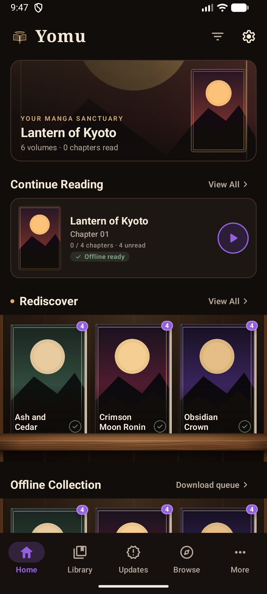
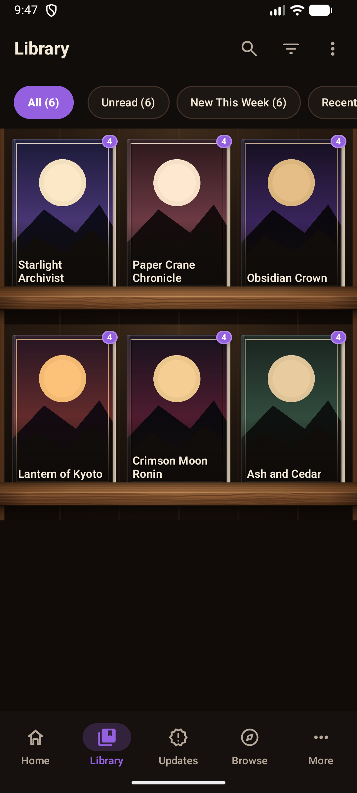
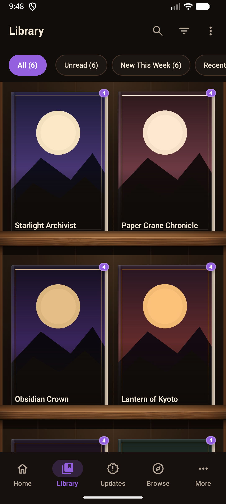
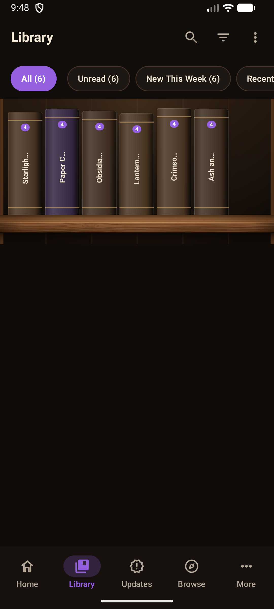
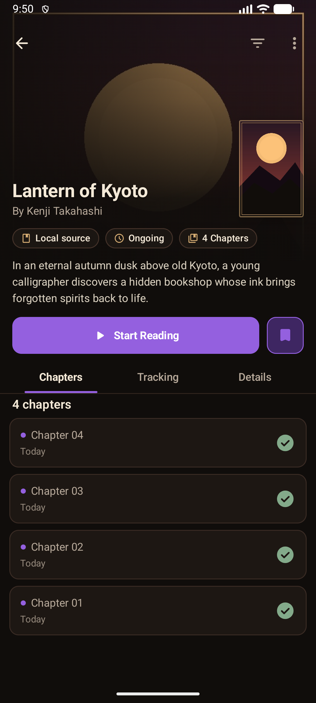
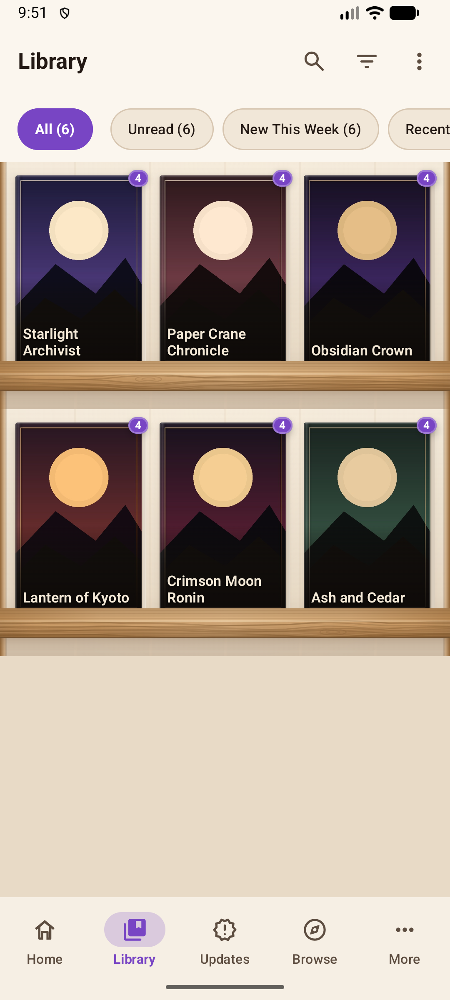
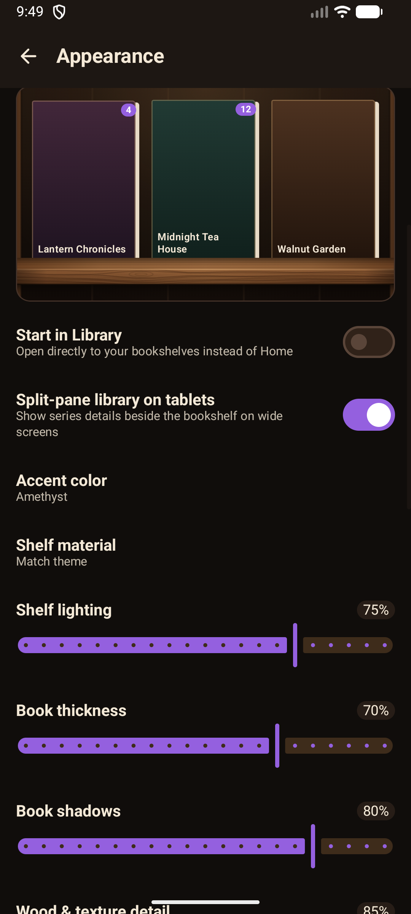
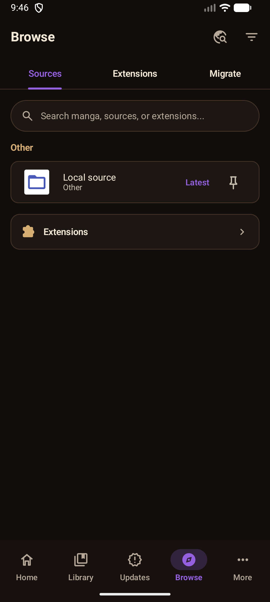
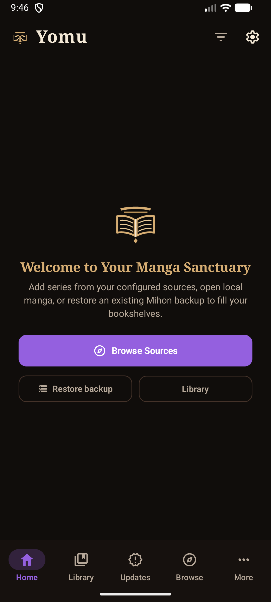
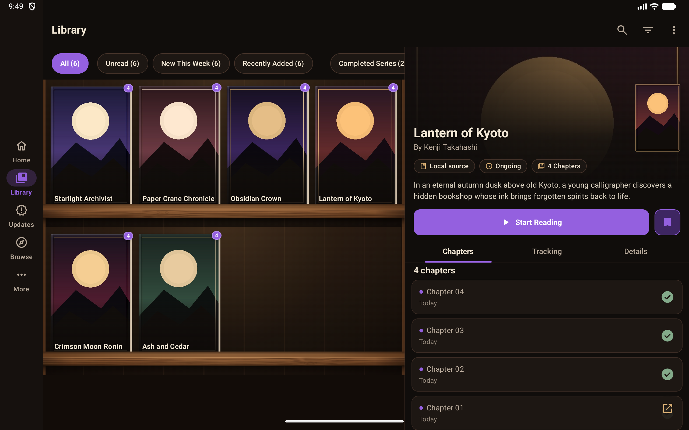

<div align="center">

# Yomu — Your Manga Sanctuary

**A native Android manga reader built on [Mihon](https://mihon.app/), redesigned as a nocturnal Japanese wooden library.**

[](/LICENSE)
[](https://github.com/Brendanbam/Yomu/releases)

</div>

---

## Visual Tour

| Home Sanctuary | Classic Bookshelf | Collector Edition |
| :---: | :---: | :---: |
|  |  |  |

| Book Spine Mode | Series Details | Natural Oak (Light) |
| :---: | :---: | :---: |
|  |  |  |

| Appearance & Live Shelf Preview | Browse Sources | Empty Sanctuary |
| :---: | :---: | :---: |
|  |  |  |

### Tablet Landscape — Split-Pane Library (`>= 840dp`)


---

## What Yomu Adds (While Preserving Full Mihon Functionality)

Yomu preserves Mihon's reader engine, local source, extensions, downloads, trackers, backups, migration, categories, and database schema (`app.yomu`), while delivering a handcrafted library experience:

- **Realistic Wooden Bookshelves (`drawWithCache`):** Procedural cathedral wood grain, recessed tongue-and-groove bookcase alcoves, warm overhead lantern lighting, parchment page-block depth, crisp physical book corners, and grounded contact shadows cached off the scroll frame path.
- **8 Library Display Modes:** `Classic Bookshelf`, `Collector Edition`, `Book Spine`, `Minimal`, `Compact Grid`, `Comfortable Grid`, `Cover-only Grid`, and `List`, using layout-aware `BoxWithConstraints` column sizing for phones, foldables, split-screen, and tablets.
- **12 Smart Shelves:** Single-pass deterministic filters separating `Currently Reading`, `Unread`, `New This Week`, `Recently Added`, `Almost Caught Up`, `Caught Up`, `Finished Reading`, `Completed Series`, `Forgotten Stories`, `Ready Offline`, and `Fully Downloaded`.
- **Truthful Home Sanctuary:** Accurate Continue Reading aligned with Mihon's `GetNextChapters` semantics (real page position without invented percentages, zero-progress honesty, offline/source availability indicators), customizable & reorderable sections (including Reset Layout and explicit empty-layout handling), honest error/retry states, Reading Overview stats, and Quick Access.
- **Tablet Split-Pane Library:** On wide screens (`>= 840dp`), tap a volume on the left bookshelf to inspect its full details, chapters, tracking, and reader launch side-by-side without losing shelf scroll position.
- **Signature Themes & Live Preview:** `Midnight Walnut` (default), `Black Ebony`, `Natural Oak` (light), `Cherry Blossom`, and `Original Mihon`, plus accent color choices, shelf material override, 5 real-time appearance sliders (`Shelf lighting`, `Book thickness`, `Book shadows`, `Wood & texture detail`, `Animation intensity`), Reduced Motion (also honoring Android's system animator scale), a live interactive Bookshelf Preview in Appearance Settings, and one-tap Reset Yomu defaults.
- **Controller & Keyboard Focus:** Single-stop D-pad focus highlights with automatic scroll-into-view across shelf rows, cards, and buttons.

---

## Installation & Updating

Requires **Android 8.0 (API 26) or higher**.

### Choosing the Right APK (ABI Guide)
Download signed release APKs from [GitHub Releases](https://github.com/Brendanbam/Yomu/releases):

| APK File | Target Devices |
| :--- | :--- |
| `yomu-vX.Y.Z-arm64-v8a.apk` | **Recommended** for modern 64-bit Android phones and tablets (e.g., Legion Y700, Pixel, Galaxy). |
| `yomu-vX.Y.Z-universal.apk` | Universal fallback containing all Android ABIs. |
| `yomu-vX.Y.Z-armeabi-v7a.apk` | Older 32-bit ARM devices. |
| `yomu-vX.Y.Z-x86_64.apk` / `x86.apk` | Android emulators and x86 tablets. |

Each release also ships `yomu-vX.Y.Z-checksums.sha256` for SHA-256 verification.

### Updating Automatically with Obtainium
1. Open **Obtainium** → **Add App**.
2. Enter `https://github.com/Brendanbam/Yomu`.
3. Under **Filter APKs by Regular Expression**, set:
   - `arm64-v8a\.apk$` for modern 64-bit devices (recommended), or
   - `universal\.apk$` for universal builds.
4. Save — Obtainium will track new tagged releases and upgrade Yomu in place (`applicationId = app.yomu`).

---

## Migrating from Mihon

Yomu uses its own application ID (`app.yomu`) so it can be installed safely alongside Mihon without overwriting Mihon's data:

1. In **Mihon**: go to **More → Data and storage → Create backup** (`.tachibk`).
2. In **Yomu**: tap **Restore backup** on the Home screen (or go to **Settings → Data and storage → Restore backup**) and select your `.tachibk` file.
3. Configure your storage folder in **Settings → Data and storage** to reuse local manga or downloads.

---

## Building & Verifying Locally

Requires **JDK 21** and the **Android SDK** (compileSdk 37 / minSdk 26).

```bash
# Formatting check (ktlint via Spotless)
./gradlew spotlessCheck

# Unit tests (JUnit 5 + Kotest)
./gradlew testDebugUnitTest

# SQLDelight schema migration verification
./gradlew verifySqlDelightMigration

# Debug APK
./gradlew :app:assembleDebug

# Release APK (CI verification build)
./gradlew :app:assembleRelease -Pdist=ci
```

On Windows, use `.\gradlew.bat`.

---

## Known Limitations

- Yomu currently publishes standard signed release APKs only; FOSS and nightly preview release channels are not published separately, so the in-app updater returns no updates on those build types.
- Book Spine mode renders deterministic cloth/leather bindings derived from series metadata rather than publisher spine artwork.
- Yomu does not host content or bundle third-party manga extensions.

---

## Attribution & License

Yomu is built on the open-source **[Mihon](https://github.com/mihonapp/mihon)** project (`Copyright © 2015 Javier Tomás`, `Copyright © 2024 Mihon Open Source Project`), with all Mihon and third-party open-source licenses preserved in the application's **About → Open source licenses** screen and in [LICENSE](LICENSE).

```text
Licensed under the Apache License, Version 2.0 (the "License");
you may not use this file except in compliance with the License.
You may obtain a copy of the License at

    http://www.apache.org/licenses/LICENSE-2.0

Unless required by applicable law or agreed to in writing, software
distributed under the License is distributed on an "AS IS" BASIS,
WITHOUT WARRANTIES OR CONDITIONS OF ANY KIND, either express or implied.
See the License for the specific language governing permissions and
limitations under the License.
```
